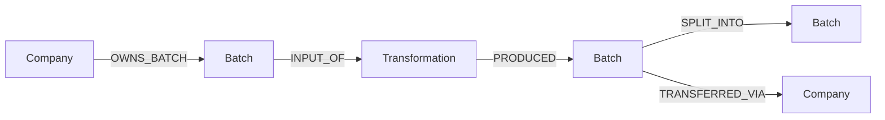

# TRACEABILITY
Genealogía textil y privacidad entre empresas.

Tecnologías: Java 21, Spring Boot, Neo4j y Kafka.
Hola, para abrirlo en local revisa [INSTRUCCIONES_DESPLIEGUE_LOCAL.md](../../INSTRUCCIONES_DESPLIEGUE_LOCAL.md) :)

## Ejecución local

- Puerto: `8084`
- Variables de entorno:
    - `NEO4J_URI`: conexión a Neo4j (obligatoria)
    - `KAFKA_BOOTSTRAP_SERVERS`: brokers de Kafka (por defecto `localhost:9092`)
- Perfil local: `application-local.yml`

## Endpoints

Todos son de solo lectura y requieren rol `OPERATOR` o `COMPANY_ADMIN`.

| Método | Ruta | Historia | Descripción |
|---|---|---|---|
| GET | `/api/traceability/lineages?qrCode=&traceabilityId=&page=&size=` | US30 | Buscar genealogías por QR o Traceability ID (máx. 100 por página) |
| GET | `/api/traceability/batches/{batchId}/ancestors` | US31 | Trazabilidad hacia atrás (hasta 10 niveles) |
| GET | `/api/traceability/batches/{batchId}/descendants` | US32 | Trazabilidad hacia adelante (hasta 10 niveles) |
| GET | `/api/traceability/batches/{batchId}/lineage` | US36 | Genealogía completa con historial de transferencias |

Las respuestas llevan `Cache-Control: no-store` porque lo visible depende de la empresa que consulta.

## Modelo del grafo (Neo4j)

Solo `INPUT_OF`, `PRODUCED` y `SPLIT_INTO` forman la genealogía. `OWNS_BATCH` indica el dueño actual y `TRANSFERRED_VIA` es historial: una transferencia no crea lotes ni relaciones padre-hijo.

## Mensajería (Kafka)

**Consume**
| Tópico | Origen |
|---|---|
| `orgaccess.company` | organization-access |
| `production.batch` | production |
| `production.transformation` | production |
| `production.transfer` | production |
| `quality.control` | quality |
| `quality.failure` | quality |

**Produce**
| Tópico | Evento |
|---|---|
| `traceability.impact` | `PossibleDerivedFailureDetected` (US33) |

Los eventos inválidos van a su tópico `.DLT`.